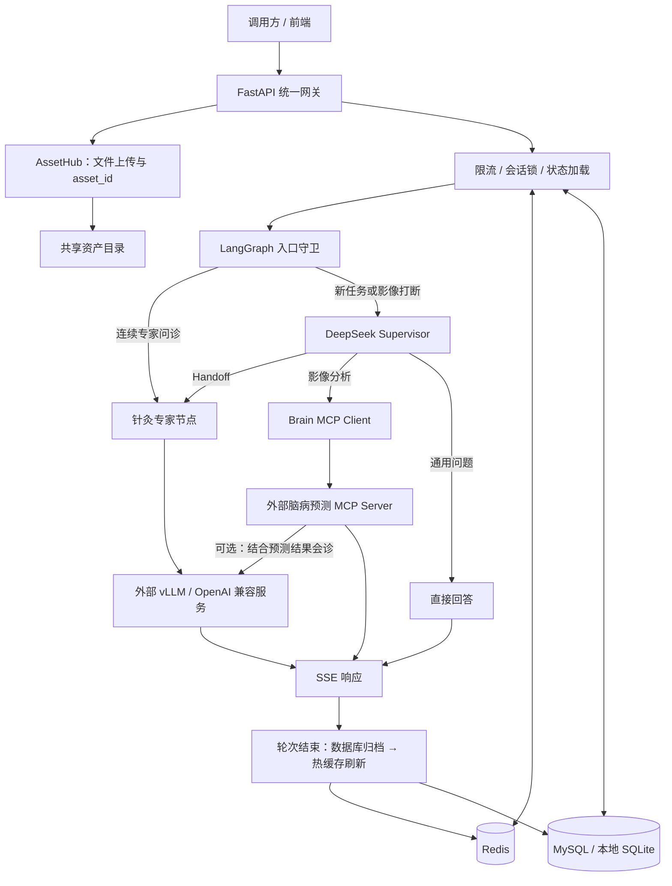

<div align="center">

# Medical Agent

### 面向医学问答与脑影像分析的多智能体协作后端

**LangGraph 编排 · 专家 Handoff · MCP 工具接入 · SSE 流式交互 · Redis / MySQL 会话存储**


</div>

## 项目概览

Medical Agent 将通用大模型、领域专家模型和医学影像工具接入同一个会话入口。用户可以通过自然语言发起中医针灸咨询，也可以上传脑部影像，调用外部预测工具，再结合定量结果生成解释与调理建议。

项目围绕三类工程问题展开：**多模型之间如何交接控制权、长对话如何保留关键状态、长耗时推理如何接入 Web 服务**。实现上采用 DeepSeek Supervisor 决策、LangGraph 状态图编排、专家模型直接流式输出，以及 Redis 热状态与关系数据库归档。

本仓库提供从原 DAO 平台演进而来的 Python 后端核心，包括编排、模型客户端、资产管理、会话存储，以及部分旧业务接口的兼容实现。前端、模型训练与权重、脑病预测 MCP Server 独立于本仓库。

## 核心能力

| 能力 | 实现方式 | 设计价值 |
| --- | --- | --- |
| 多智能体编排 | Supervisor 输出 JSON 决策，LangGraph `Command` 切换节点 | 将意图判断、专家问答、影像工具执行拆成明确职责 |
| 专家控制权移交 | Handoff 后由针灸专家模型直接生成 SSE token | 省去总控对专家回答的再次转述，保留专家的问答风格 |
| 多轮粘性路由 | 持久化 `sticky_agent`，新资产或影像关键词触发重新路由 | 连续问诊可跳过总控调用，任务变化时重新决策 |
| 上下文管理 | 历史消息预算滑窗 + 独立保存阳性 / 否定症状槽位 | 分别管理对话文本和关键结构化信息 |
| 多模态工具接入 | AssetHub 生成 `asset_id`，MCP 客户端调用外部影像工具 | 将大文件存储与模型编排分开，工具参数保持轻量 |
| 会话恢复 | Redis 活跃状态、MySQL 轮次归档、缓存未命中回源 | 支持热状态过期后恢复路由、槽位和最近消息 |
| 请求与任务治理 | 会话锁、Lua 滑动窗口限流、任务快照与 Pub/Sub | 为并发对话和耗时工具调用提供基础控制能力 |

## 系统架构



### 一次请求如何执行

1. 网关按 `session_id` 检查限流，并尝试获取会话锁。
2. 优先读取热状态；缓存未命中时，从数据库恢复线程元数据和最近 40 条消息。
3. 入口节点解析新资产、更新症状槽位、裁剪历史，并判断是否沿用专家路由。
4. Supervisor 在专家 Handoff、脑病 MCP 调用和直接回答之间选择。JSON 解析失败时使用启发式规则回退。
5. 专家问答分支直接读取模型流并发送 token；影像分支执行 MCP 调用，可追加专家会诊，并输出结果与 `_artifact`。
6. 回复生成结束后，以短事务归档本轮问答，再刷新热缓存，最后发送 `done`。

## 关键设计

### 1. Handoff 与 Tool Call 分工

针灸专家承担持续的多轮交互，因此采用 Handoff：总控选定专家后，网关将专家模型输出直接转成 SSE。脑病预测承担一次明确的影像计算，因此作为 MCP Tool 调用，返回预测结果和可选的可视化产物。

`sticky_agent` 随会话保存。连续补充症状时，入口守卫可以直达专家；用户上传新资产或提到影像任务时，守卫清除粘性状态，把控制权交回 Supervisor。这里的打断发生在**新一轮请求的入口**。

源码：[编排状态图](app/agents/orchestrator_graph.py) · [专家流式生成](app/agents/tcm_acupuncture_agent.py)

### 2. 历史滑窗与结构化槽位分别管理

历史消息从最近一条向前选取，按字符长度估算 token，默认历史预算为 3,000。阳性与否定症状单独写入 `clinical_slots`，再注入专家 Prompt，避免关键事实完全依赖历史文本。

例如，输入“失眠多梦，没有发热”，槽位更新逻辑可保留“失眠”“多梦”和“无发热”。当前提取器采用症状词表和分句级否定规则；检索模块采用内置知识条目的关键词匹配，将配穴依据、操作提示和禁忌文本加入 Prompt。

槽位与检索逻辑集中在专家模块，方便检查状态变化和替换提取器。token 预算是近似控制；当最新单条消息超过预算时，当前实现仍保留该条。

源码：[上下文预算](app/agents/orchestrator_graph.py) · [症状槽位与检索](app/agents/tcm_acupuncture_agent.py)

### 3. 会话状态与数据库连接生命周期

Redis 保存最近消息、专家路由、症状槽位和资产元数据，默认会话 TTL 为 2 小时，读取时续期。数据库以 `agent_threads` 保存线程状态，以 `agent_messages` 保存每轮问答及产物。

SSE 生成期间不持续占用数据库连接。缓存未命中时先用短会话读取历史，回复生成结束后再用短事务归档，随后更新 Redis。恢复依赖已成功提交的轮次，`done.persisted_to_mysql` 用于检查本轮数据库写入是否成功；SQLite 演示模式也沿用这一字段名。

源码：[状态缓存与恢复](app/cache/session_state_store.py) · [数据库归档](app/storage/session_repository.py)

### 4. Claim-Check 管理医学大文件

上传文件保存在资产目录，AssetHub 返回短凭据 `asset_id`，并缓存文件类型、大小和存储位置。MCP 工具参数传递凭据，避免将文件二进制内容写入对话或工具请求。当前总控 Prompt 会附带资产元数据。

外部 MCP Server 需要实现相同的资产解析约定：共享文件目录，或按凭据通过下载接口读取文件。仅填写 MCP 地址不会自动建立跨服务的文件访问能力。

源码：[资产服务](app/asset_hub/asset_service.py) · [MCP 客户端](app/mcp_client/brain_mcp_client.py)

### 5. Redis 在请求链路中的职责

| 场景 | 数据结构 / 机制 | 代码 |
| --- | --- | --- |
| 会话热状态 | JSON String + TTL | [session_state_store.py](app/cache/session_state_store.py) |
| 同会话并发互斥 | `SET NX EX` + token 校验 Lua 解锁 | [redis_client.py](app/cache/redis_client.py) |
| 请求限流 | ZSET + Lua 原子裁剪、计数与写入 | [auth_and_ratelimit.py](app/cache/auth_and_ratelimit.py) |
| JWT 注销记录 | token 摘要 + 剩余有效期 TTL | [auth_and_ratelimit.py](app/cache/auth_and_ratelimit.py) |
| 分类树缓存 | Cache-Aside + 重建锁 + 二次检查 | [routers_java_compat.py](app/legacy_java_migrated/routers_java_compat.py) |
| 工具任务进度 | Hash 快照 + Pub/Sub 事件 | [task_progress_bus.py](app/cache/task_progress_bus.py) |
| 资产元数据 | JSON String + 缓存未命中时扫描目录 | [asset_service.py](app/asset_hub/asset_service.py) |

默认限流为每会话每 60 秒 20 次请求，超限返回 HTTP 429。同会话锁等待超时通过 SSE 返回 `SESSION_BUSY`。任务总线提供进度分发，工具仍在当前请求内执行；当前脑病调用发布启动与终态进度，未接入工具内部的细粒度进度回调。

## 代码结构

```text
Medical-Agent/
├── app/
│   ├── main.py                       # FastAPI 入口、SSE、轮次归档
│   ├── config.py                     # 环境变量配置
│   ├── agents/
│   │   ├── orchestrator_graph.py      # 状态图、路由、Handoff、MCP 编排
│   │   └── tcm_acupuncture_agent.py   # 专家客户端、症状槽位、关键词检索
│   ├── asset_hub/
│   │   └── asset_service.py           # 文件上传、凭据与下载
│   ├── mcp_client/
│   │   └── brain_mcp_client.py        # Streamable HTTP MCP 客户端
│   ├── cache/                        # Redis 连接池、锁、限流、缓存、任务事件
│   ├── storage/
│   │   └── session_repository.py      # 线程 / 消息持久化与历史恢复
│   └── legacy_java_migrated/          # SQLAlchemy 实体与旧业务兼容接口
├── .env.example
├── .gitignore
├── requirements.txt
└── README.md
```

## 本地运行

### 1. 安装环境

准备 Python 3.11 或更新版本。在 PowerShell 中执行：

```powershell
git clone https://github.com/zhang-xing-ye/Medical-Agent.git
cd Medical-Agent
python -m venv .venv
.\.venv\Scripts\python.exe -m pip install -r requirements.txt
Copy-Item .env.example .env
```

### 2. 填写配置

运行以下命令，分别生成 JWT 签名密钥与 Base64 编码的 16 字节 AES 密钥，将输出填入 `.env` 的 `SIGNATURE`、`AES_SECRET_KEY`。密钥只保存在本地。

```powershell
.\.venv\Scripts\python.exe -c "import secrets; print(secrets.token_hex(32))"
.\.venv\Scripts\python.exe -c "import base64,secrets; print(base64.b64encode(secrets.token_bytes(16)).decode())"
```

| 配置 | 用途 |
| --- | --- |
| `DEEPSEEK_API_KEY` / `SUPERVISOR_MODEL` | 总控模型的凭据与名称 |
| `TCM_VLLM_BASE_URL` / `TCM_VLLM_API_KEY` / `TCM_MODEL_NAME` | 独立部署的 OpenAI 兼容专家模型 |
| `BRAIN_AD_MCP_URL` | 外部脑病预测 MCP 服务地址 |
| `REDIS_URL` | 热状态、锁、限流与进度总线 |
| `USE_SQLITE_FALLBACK` | `true` 显式选择 SQLite；`false` 使用 MySQL |
| `DATABASE_URL` | MySQL 异步连接串，数据库需预先创建 |
| `SHARED_ASSET_DIR` | 可选的资产目录，默认 `storage/assets` |

`.env.example` 默认选择 SQLite，便于单机演示。Redis 启动连接失败时提供进程内存降级，适合单进程调试。中医问答需要可用的总控与专家模型；脑影像流程还需要 MCP Server 和双方一致的资产访问配置。

### 3. 启动后端

```powershell
.\.venv\Scripts\python.exe -m uvicorn app.main:app --host 127.0.0.1 --port 8081
```

打开 [Swagger UI](http://127.0.0.1:8081/docs) 查看请求结构。启动时自动创建 Agent 线程与消息表；旧用户、分类、模型和会话表需接入已有数据库另行准备。

### 4. 发起多轮对话

下面的 Python 示例使用标准库逐行读取 SSE：

```python
import json
from urllib.request import Request, urlopen

payload = {
    "session_id": "demo-001",
    "query": "最近失眠多梦，想咨询中医调理。",
    "asset_ids": [],
}
request = Request(
    "http://127.0.0.1:8081/api/v1/agent/chat/stream",
    data=json.dumps(payload).encode("utf-8"),
    headers={"Content-Type": "application/json"},
)
with urlopen(request) as response:
    for line in response:
        print(line.decode("utf-8"), end="", flush=True)
```

保持相同 `session_id` 再补充症状，可观察专家路由与槽位变化。也可在 Swagger UI 中上传 `.nii`、`.nii.gz` 或 `.npy` 文件，将返回的 `asset_id` 放入下一轮 `asset_ids`。

前端可通过 `fetch` 发送 POST 请求并读取响应流。普通 `EventSource` 使用 GET，不能直接发送此对话接口所需的 POST JSON 请求。

## API 与事件协议

| 方法 | 路径 | 功能 |
| --- | --- | --- |
| `POST` | `/api/v1/agent/chat/stream` | 统一会话入口，返回 SSE |
| `POST` | `/api/v1/assets/upload` | Multipart 文件上传，返回资产凭据 |
| `GET` | `/api/v1/assets/{asset_id}/download` | 读取资产文件 |
| `GET` | `/api/v1/mcp/tools` | 查询外部 MCP 工具及连接状态 |
| `GET` | `/api/v1/tasks/{task_id}` | 查询任务快照 |
| `GET` | `/api/v1/tasks/{task_id}/events` | 订阅任务进度 SSE |
| `GET` | `/api/v1/sessions/{session_id}/history` | 查询数据库归档 |
| `GET` | `/api/v1/redis/inspect/{session_id}` | 检查热状态与 TTL |
| `DELETE` | `/api/v1/redis/session/{session_id}` | 清理指定会话热状态，用于恢复演示 |

保留的旧业务接口位于 `/user/*`、`/category/*`、`/model/*`、`/session/*`，响应结构为 `{state, message, data}`；其中注册接口当前为预留实现。

SSE 帧格式为 `event: <类型>` 与 `data: <JSON>`，主要事件包括：

| 事件 | 含义 |
| --- | --- |
| `handoff` / `router_trace` | 专家移交或粘性路由说明 |
| `token` | 文本增量；针灸专家分支逐 token 输出，会诊分支返回完整生成结果 |
| `tool_start` / `task_created` | 工具调用与任务标识 |
| `artifact` | 外部工具返回的可视化产物 |
| `consultation_start` | 影像结果追加专家会诊的说明 |
| `done` | 轮次完成，包含状态来源、数据库写入结果、槽位与后端类型 |
| `error` | 当前用于会话锁等待超时 |

编排器先完成 `ainvoke`，再由网关发送收集的路由与工具事件，因此这些事件的到达时间不等同于工具的执行时间。需要实时观察任务进度时，使用独立的任务订阅接口。

## 源码导读与演示路径

建议从 [app/main.py](app/main.py) 开始，依次阅读状态图、专家节点、会话存储和 Redis 基础设施。

| 演示场景 | 操作 | 观察点 |
| --- | --- | --- |
| 专家接管 | 新会话发起针灸咨询 | `handoff` 与专家文本流 |
| 多轮追问 | 同一会话补充“没有发热，舌红少苔” | `sticky_handoff` 路由、症状槽位 |
| 任务切换 | 挂载新影像并提出分析需求 | 重新进入 Supervisor，调用脑病工具 |
| 历史恢复 | 确认本轮数据库写入成功，再清理热缓存并继续对话 | `done.state_source` 为 `mysql_recovered` |
| 并发保护 | 在锁有效期内对同一会话发送重叠请求 | 锁等待超时后的 `SESSION_BUSY` |
| 请求限流 | 在窗口内超过会话配额 | HTTP 429 |

## 验证范围与后续方向

本次在 Python 3.11 独立环境中完成了启动与本地冒烟检查：

- FastAPI 启动、OpenAPI 生成、SSE 帧解析。
- 使用模拟模型验证 Supervisor 路由、专家 Handoff 与多轮粘性路由。
- SQLite 实际写入、历史读取、热缓存复用，以及清理热状态后的数据库恢复。
- 症状槽位更新、随机生成密钥的 JWT / AES 往返验证、内存降级限流，以及缺失密钥时的明确报错。

检查使用 Redis 内存降级，模型响应采用模拟数据；真实 Redis / MySQL、外部模型与 MCP 影像推理需要单独联调。

当前版本已包含上述后端实现，仓库尚未提供模型训练产物、临床评测报告或性能压测结果。模型名称用于配置外部服务，模型效果与响应时延需在具体部署环境中验证。医学输出用于研究与辅助参考。

部署与扩展时需结合以下实现条件：

- **状态一致性：** 数据库与 Redis 按顺序写入，未实现跨存储原子事务；中途断流、进程退出或写库失败的轮次需要补偿机制。
- **并发与降级：** 会话锁固定租期为 120 秒，当前未自动续租；内存降级仅在单进程内共享状态。
- **接口访问：** 已提供 JWT 签发、校验与注销辅助函数，Agent 和调试接口尚未统一接入鉴权与会话归属校验。旧登录兼容逻辑需在对外服务前完善。
- **检索与抽取：** 当前为关键词知识检索和规则槽位提取；可扩展向量检索、精细否定识别及证据质量评测。
- **工具执行：** 当前脑病节点使用最近挂载的资产；可扩展为严格校验 Supervisor 选择的资产、异步任务队列及失败重试。

后续可围绕路由调用次数、专家首字时间、工具耗时与缓存恢复成功率开展评测，以实测结果指导优化。
